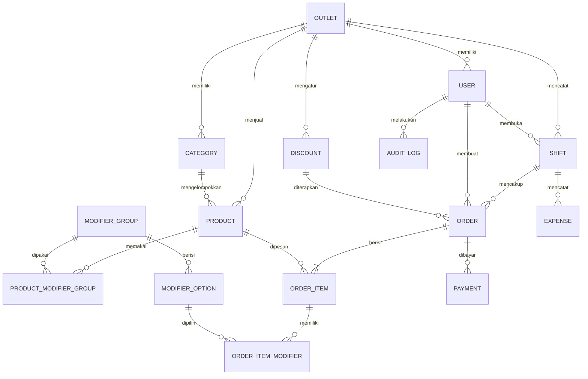

# PRD – Aplikasi POS & Laporan Penjualan Kuliner (PWA)

**Versi:** 1.0 (Draft) · **Tanggal:** 17 November 2026 · **Pemilik produk:** Pemilik usaha kuliner · **Target build:** Google AI Studio (Build mode)

## 1. Ringkasan Produk

Aplikasi kasir (Point of Sale) dan laporan penjualan untuk **satu outlet kuliner milik sendiri**. Aplikasi berbentuk **PWA** (Progressive Web App): satu kode yang bisa dibuka di browser desktop, dipasang seperti aplikasi di Android, dan tetap bisa dipakai saat internet putus.

**Masalah yang diselesaikan**

- Pencatatan penjualan manual rawan salah dan sulit direkap.
- Pemilik tidak punya gambaran cepat soal omzet, menu terlaris, dan jam ramai.
- Kasir butuh alat yang cepat dipakai saat antrean panjang.

**Visi:** Kasir bisa mencatat pesanan dalam kurang dari 30 detik, dan pemilik bisa melihat kondisi usaha hari ini dalam satu layar.

## 2. Tujuan & Indikator Keberhasilan

| Tujuan | Indikator (KPI) | Target |
| --- | --- | --- |
| Transaksi cepat | Waktu membuat pesanan 3 item sampai bayar | ≤ 30 detik |
| Data akurat | Selisih kas vs sistem saat tutup shift | ≤ 1% |
| Laporan siap pakai | Laporan harian tersedia tanpa input tambahan | 100% otomatis |
| Andal | Transaksi tetap tersimpan saat offline | 100% tersinkron setelah online |
| Adopsi | Kasir mahir setelah pelatihan singkat | ≤ 1 jam |

## 3. Pengguna & Peran

| Peran | Deskripsi | Hak akses utama |
| --- | --- | --- |
| **Owner** | Pemilik usaha | Semua fitur, laporan, kelola menu, kelola pengguna, pengaturan |
| **Manajer** (opsional) | Kepercayaan owner | Kelola menu, void/refund, lihat laporan |
| **Kasir** | Operator harian | Buat pesanan, terima pembayaran, buka/tutup shift, lihat riwayat miliknya |

## 4. Ruang Lingkup

**Masuk versi 1 (MVP):** POS & pesanan, manajemen menu, pembayaran (tunai & QRIS), struk, shift kasir, laporan & analitik penjualan, manajemen pengguna, mode offline.

**Di luar versi 1 (roadmap):** inventori & resep bahan baku, multi-outlet/franchise, integrasi GoFood/GrabFood/ShopeeFood, program loyalitas pelanggan, payment gateway otomatis, akuntansi penuh.

## 5. Fitur & Kebutuhan Fungsional

Prioritas: **M** = Must (wajib MVP), **S** = Should, **C** = Could.

### 5.1 Autentikasi & Pengguna

- **M** Login email/password dan Google Sign-In (Firebase Authentication).
- **M** Login cepat Kasir dengan PIN 4–6 digit pada perangkat kasir yang sudah terdaftar.
- **M** Peran Owner / Manajer / Kasir dengan pembatasan akses.
- **S** Log aktivitas (siapa void, siapa ubah harga).

### 5.2 Manajemen Menu

- **M** CRUD kategori dan produk (nama, harga, foto, status tersedia/habis, SKU opsional).
- **M** Varian dan tambahan (modifier), misalnya level pedas, ukuran, topping, dengan harga tambahan.
- **S** Produk paket/bundle.
- **S** Impor menu dari CSV/Excel.
- **C** Jadwal ketersediaan menu (misalnya menu sarapan).

### 5.3 POS & Pesanan

- **M** Grid menu dengan pencarian dan filter kategori.
- **M** Keranjang: ubah jumlah, catatan per item, hapus item.
- **M** Tipe pesanan: Makan di tempat, Bawa pulang, Delivery (manual).
- **M** Nomor meja atau nama pelanggan (opsional) dan nomor antrean otomatis.
- **M** Diskon (nominal/persen) dan pajak/biaya layanan yang bisa diatur.
- **M** Simpan pesanan (hold) dan lanjutkan nanti.
- **M** Status pesanan: Baru → Diproses → Siap → Selesai / Dibatalkan.
- **S** Layar dapur (Kitchen Display) sederhana: daftar pesanan masuk real-time.
- **S** Pisah tagihan (split bill).
- **C** Pesanan lewat QR meja oleh pelanggan.

### 5.4 Pembayaran

- **M** Tunai dengan kalkulator kembalian dan tombol nominal cepat.
- **M** QRIS: tampilkan QRIS toko, kasir mengonfirmasi pembayaran masuk.
- **M** Pembayaran campuran (tunai + non-tunai).
- **S** Transfer bank / e-wallet lain (dicatat manual).
- **C** Payment gateway otomatis (Midtrans/Xendit) dengan status real-time.

### 5.5 Struk & Perangkat

- **M** Struk digital: tampilan layar, bagikan lewat WhatsApp, simpan PDF.
- **S** Cetak ke printer thermal Bluetooth/USB (ESC/POS) melalui Web Bluetooth/WebUSB.
- **S** Kustomisasi header/footer struk dan logo.
- **C** Pembuka laci kas otomatis.

### 5.6 Shift & Kas

- **M** Buka shift dengan modal awal kas.
- **M** Tutup shift: sistem menghitung kas yang seharusnya, kasir memasukkan kas aktual, selisih ditampilkan.
- **S** Catat pengeluaran/kas keluar selama shift (beli es batu, gas, dll.).

### 5.7 Riwayat Transaksi & Koreksi

- **M** Daftar transaksi dengan filter tanggal, status, kasir, metode bayar.
- **M** Void/refund dengan alasan wajib dan otorisasi Manajer/Owner.
- **S** Cetak ulang struk.

### 5.8 Laporan & Analitik

- **M** Dashboard Owner: omzet hari ini, jumlah transaksi, rata-rata nilai pesanan, perbandingan dengan kemarin/minggu lalu.
- **M** Laporan penjualan per hari/minggu/bulan/rentang kustom.
- **M** Menu terlaris dan menu paling sedikit terjual.
- **M** Penjualan per kategori, per metode bayar, per tipe pesanan, per kasir.
- **M** Jam ramai (heatmap jam × hari).
- **M** Laporan shift dan selisih kas.
- **M** Ekspor ke CSV/Excel dan PDF.
- **S** Laporan laba kotor sederhana (butuh harga pokok per produk).
- **S** Ringkasan harian otomatis (misalnya dikirim email ke Owner).
- **C** Insight berbasis Gemini: ringkasan teks seperti "Omzet naik 12% dibanding minggu lalu, didorong oleh menu X".

### 5.9 Pengaturan

- **M** Profil outlet (nama, alamat, logo, NPWP opsional, jam operasional).
- **M** Pajak dan biaya layanan, mata uang Rupiah, format tanggal Indonesia.
- **M** Kelola pengguna dan PIN.
- **S** Tema terang/gelap, ukuran font.

### 5.10 PWA & Offline

- **M** Bisa di-install (Add to Home Screen di Android, Install di Chrome/Edge desktop).
- **M** Offline-first: menu dan transaksi disimpan lokal, sinkron otomatis saat online.
- **M** Indikator status koneksi dan antrean sinkronisasi.
- **S** Pembaruan aplikasi otomatis di latar belakang.

## 6. Alur Pengguna Utama

**Alur kasir:** Login PIN → Buka shift (modal awal) → Pilih menu → Atur varian/jumlah → Pilih tipe pesanan → Bayar (tunai/QRIS) → Cetak/kirim struk → Ulangi → Tutup shift.

**Alur owner:** Login → Dashboard → Pilih periode → Lihat menu terlaris/jam ramai → Ekspor laporan → Ubah harga/menu bila perlu.

**Alur offline:** Internet putus → banner "Mode Offline" → transaksi tetap dibuat dan disimpan lokal → internet kembali → sinkron otomatis → banner hilang.

## 7. Teknologi

| Lapisan | Pilihan | Alasan |
| --- | --- | --- |
| Platform | **PWA** (service worker + web manifest) | Satu kode untuk desktop dan Android, tanpa Play Store |
| Frontend | **React + TypeScript + Tailwind CSS** | Default AI Studio Build mode, ekosistem luas |
| Komponen UI | shadcn/ui atau Radix + ikon Lucide | Aksesibel dan konsisten |
| Grafik | Recharts | Mudah untuk dashboard |
| State | Zustand atau React Context | Ringan untuk POS |
| Backend & DB | **Firebase**: Firestore, Authentication, Hosting, Cloud Functions bila perlu | Integrasi satu klik di AI Studio, offline persistence bawaan |
| Offline | Firestore offline persistence + service worker (Workbox) | Transaksi aman saat internet putus |
| Cetak struk | Web Bluetooth / WebUSB (ESC/POS), fallback cetak browser | Mendukung printer thermal umum |
| Ekspor | SheetJS (Excel), jsPDF/print-to-PDF | Laporan siap pakai |
| AI opsional | Gemini API lewat sisi server | Insight laporan |

**Catatan hasil riset tentang AI Studio**

- \<cite index="3-1">AI Studio membuat frontend web (default React) dan runtime server Node.js untuk panggilan API aman dan koneksi database.\</cite>
- \<cite index="2-1">Untuk aplikasi web, Build mode menyediakan Firestore dan Firebase Authentication secara otomatis, dan tidak ada opsi memakai backend lain sejak awal.\</cite> Karena itu PRD ini memakai Firebase sebagai backend. Jika ingin SQL (PostgreSQL/Supabase), proyek perlu dipindah ke luar AI Studio.
- \<cite index="18-1">Aplikasi Android dari Build mode saat ini hanya sisi klien (tanpa Firebase) dan ditujukan untuk penggunaan pribadi atau Internal Test Track.\</cite> Itu alasan PWA lebih tepat untuk kebutuhan POS ini.
- \<cite index="8-1">Build mode paling cocok untuk aplikasi CRUD seperti pelacak inventori dan CRM sederhana\</cite>, sesuai dengan sifat aplikasi POS.
- \<cite index="17-1">Kuota gratis Firebase Spark cukup untuk prototipe dan trafik rendah.\</cite> Untuk operasional harian, siapkan paket Blaze dengan batas anggaran.

**Keterbatasan yang perlu diketahui:** Web Bluetooth/WebUSB berjalan di Chrome/Edge (desktop dan Android), tidak di iOS Safari. Firestore adalah database NoSQL, jadi ERD di bawah adalah model logis yang dipetakan ke koleksi.

## 8. Desain & UX

### 8.1 Prinsip

1. **Cepat di jari:** target sentuh minimal 48 px, aksi utama maksimal 2 ketukan.
2. **Jelas saat sibuk:** kontras tinggi, teks besar untuk harga dan total.
3. **Satu kode, tiga layout:** menyesuaikan layar desktop, tablet, dan ponsel.
4. **Tahan gangguan:** status offline, konfirmasi aksi berisiko (void, hapus).

### 8.2 Identitas Visual (usulan, bisa diganti)

- **Nuansa:** hangat, bersih, bernafsu makan.
- **Warna utama:** oranye hangat `#F97316`; **aksen:** hijau segar `#16A34A` (sukses/bayar), merah `#DC2626` (void/error), kuning `#F59E0B` (peringatan).
- **Netral:** latar `#FAFAF9`, teks `#1C1917`, garis `#E7E5E4`; mode gelap tersedia.
- **Tipografi:** Inter atau Plus Jakarta Sans; angka harga pakai tabular numbers.
- **Bentuk:** sudut membulat 12 px, bayangan lembut, ikon Lucide.

### 8.3 Layout per Perangkat

| Perangkat | Layout POS |
| --- | --- |
| **Desktop / tablet landscape** | Tiga area: sidebar navigasi ramping (kiri), grid menu (tengah, 60%), keranjang dan total (kanan, 30%) |
| **Android ponsel** | Grid menu penuh layar, bilah bawah berisi ringkasan keranjang yang bisa ditarik naik, navigasi tab bawah |
| **Dashboard** | Kartu KPI di atas, grafik tren, tabel menu terlaris, heatmap jam ramai; di ponsel disusun satu kolom |

### 8.4 Daftar Layar

1. Login (email/Google/PIN)
2. Buka shift
3. POS (menu + keranjang)
4. Pilih varian/modifier (modal)
5. Pembayaran (tunai/QRIS/campuran)
6. Struk (tampil, bagikan, cetak)
7. Pesanan aktif dan hold
8. Riwayat transaksi dan detail
9. Tutup shift
10. Dashboard Owner
11. Laporan (penjualan, produk, kategori, kasir, jam ramai)
12. Kelola menu (kategori, produk, modifier)
13. Kelola pengguna
14. Pengaturan outlet, pajak, struk, printer

### 8.5 Kondisi Khusus

Keranjang kosong, menu habis, offline, sinkron gagal, printer tidak terhubung, selisih kas, dan sesi kedaluwarsa masing-masing punya tampilan dan pesan sendiri berbahasa Indonesia.

## 9. Model Data & ERD

### 9.1 Diagram Relasi (ERD Logis)

### 9.2 Kamus Data

**OUTLET** (1 dokumen pengaturan)

- `id`, `name`, `address`, `phone`, `logo_url`, `tax_percent`, `service_charge_percent`, `receipt_header`, `receipt_footer`, `qris_image_url`, `timezone` (default Asia/Jakarta), `currency` (IDR)

**USER**

- `id` (uid Firebase), `outlet_id`, `name`, `email`, `role` (owner/manager/cashier), `pin_hash`, `is_active`, `created_at`

**CATEGORY**

- `id`, `outlet_id`, `name`, `sort_order`, `is_active`

**PRODUCT**

- `id`, `outlet_id`, `category_id`, `name`, `sku`, `price`, `cost_price` (opsional), `image_url`, `is_available`, `is_active`, `created_at`, `updated_at`

**MODIFIER\_GROUP**

- `id`, `outlet_id`, `name` (misalnya Level Pedas), `is_required`, `min_select`, `max_select`

**MODIFIER\_OPTION**

- `id`, `group_id`, `name`, `extra_price`, `is_active`

**PRODUCT\_MODIFIER\_GROUP** (tabel penghubung)

- `product_id`, `modifier_group_id`

**SHIFT**

- `id`, `outlet_id`, `user_id`, `opened_at`, `closed_at`, `opening_cash`, `expected_cash`, `actual_cash`, `cash_difference`, `status` (open/closed), `note`

**ORDER**

- `id`, `order_number` (misalnya 20261117-0001), `queue_number`, `outlet_id`, `shift_id`, `user_id`, `order_type` (dine\_in/takeaway/delivery), `table_or_customer_name`, `status` (new/preparing/ready/completed/cancelled/void), `subtotal`, `discount_id`, `discount_amount`, `tax_amount`, `service_amount`, `total`, `paid_amount`, `change_amount`, `note`, `created_at`, `completed_at`, `void_reason`, `void_by`, `sync_status`

**ORDER\_ITEM**

- `id`, `order_id`, `product_id`, `product_name_snapshot`, `unit_price_snapshot`, `qty`, `line_total`, `note`

**ORDER\_ITEM\_MODIFIER**

- `id`, `order_item_id`, `modifier_option_id`, `name_snapshot`, `extra_price_snapshot`

**PAYMENT**

- `id`, `order_id`, `method` (cash/qris/transfer/ewallet), `amount`, `reference`, `paid_at`, `received_by`

**DISCOUNT**

- `id`, `outlet_id`, `name`, `type` (percent/nominal), `value`, `is_active`

**EXPENSE**

- `id`, `shift_id`, `description`, `amount`, `created_by`, `created_at`

**AUDIT\_LOG**

- `id`, `user_id`, `action`, `entity`, `entity_id`, `detail`, `created_at`

### 9.3 Pemetaan ke Firestore

- Koleksi tingkat atas: `outlet`, `users`, `categories`, `products`, `modifierGroups`, `shifts`, `orders`, `discounts`, `expenses`, `auditLogs`.
- **Denormalisasi:** `orderItems`, `modifier terpilih`, dan `payments` disimpan sebagai array di dalam dokumen `orders`, supaya satu transaksi ditulis dalam satu operasi (aman offline dan murah).
- **Snapshot harga:** nama dan harga produk disalin ke item pesanan agar laporan lama tidak berubah saat harga diubah.
- **Agregat laporan:** dokumen ringkasan harian `dailyStats/{yyyy-mm-dd}` (omzet, jumlah transaksi, per produk, per jam) diperbarui lewat Cloud Function atau transaksi klien, supaya dashboard cepat dan hemat biaya baca.
- **Indeks komposit** untuk `orders` berdasarkan `created_at`, `status`, `user_id`, dan `shift_id`.

### 9.4 Aturan Keamanan (Firestore Rules)

- Hanya pengguna terautentikasi dan aktif yang dapat membaca/menulis.
- Kasir: baca menu, buat pesanan, dan baca pesanannya sendiri. Tidak boleh mengubah harga atau menghapus pesanan.
- Manajer: ditambah void/refund dan kelola menu.
- Owner: akses penuh termasuk pengguna dan pengaturan.
- Pesanan yang sudah selesai tidak dapat diubah, hanya di-void dengan alasan dan tercatat di audit log.

## 10. Kebutuhan Non-Fungsional

| Aspek | Kebutuhan |
| --- | --- |
| Performa | Muat awal ≤ 3 detik di Android kelas menengah; interaksi POS ≤ 100 ms |
| Offline | Seluruh alur kasir berjalan tanpa internet; sinkron otomatis |
| Keamanan | HTTPS, Firebase Rules, PIN ter-hash, sesi otomatis berakhir, tanpa kunci rahasia di klien |
| Kompatibilitas | Chrome/Edge terbaru (desktop & Android); Safari/Firefox untuk fitur inti |
| Aksesibilitas | Kontras WCAG AA, target sentuh ≥ 48 px, navigasi keyboard di desktop |
| Lokalisasi | Bahasa Indonesia, Rupiah tanpa desimal, zona waktu WIB |
| Cadangan | Ekspor data berkala dan backup Firestore terjadwal |
| Biaya | Berjalan di kuota gratis saat uji, anggaran terbatas saat produksi |

## 11. Peta Jalan

| Fase | Isi | Perkiraan |
| --- | --- | --- |
| **MVP (v1.0)** | Login, menu, POS, tunai & QRIS manual, struk digital, shift, riwayat, dashboard dan laporan dasar, PWA offline | 3–4 minggu |
| **v1.1** | Printer thermal, layar dapur, split bill, ekspor Excel/PDF, laporan laba kotor, impor menu | 2–3 minggu |
| **v1.2** | Payment gateway otomatis, insight Gemini, ringkasan harian via email | 2–3 minggu |
| **v2.0** | Inventori dan resep, multi-outlet/franchise, integrasi platform delivery, loyalitas | Menyusul |

## 12. Risiko & Mitigasi

| Risiko | Dampak | Mitigasi |
| --- | --- | --- |
| Printer thermal tidak kompatibel dengan browser | Struk tidak tercetak | Uji model printer lebih awal; sediakan struk digital dan cetak browser sebagai cadangan |
| Konflik data saat sinkron offline | Nomor antrean ganda | Nomor pesanan memakai prefiks perangkat dan tanggal; aturan resolusi konflik jelas |
| Biaya baca Firestore membengkak | Tagihan naik | Dokumen agregat harian, paginasi, cache lokal |
| Kode hasil AI tidak konsisten | Bug di alur pembayaran | Bangun bertahap per modul, uji skenario kasir nyata sebelum rilis |
| Ketergantungan pada Firebase | Sulit pindah backend | Pisahkan lapisan akses data (repository) agar bisa diganti |

## 13. Kriteria Penerimaan MVP

- Kasir dapat membuat pesanan dengan varian, membayar tunai/QRIS, dan melihat struk dalam ≤ 30 detik.
- Semua transaksi saat offline tersimpan dan tersinkron tanpa duplikasi.
- Tutup shift menampilkan selisih kas dengan benar.
- Dashboard menampilkan omzet, jumlah transaksi, menu terlaris, dan jam ramai yang cocok dengan data mentah.
- Kasir tidak bisa mengakses laporan, pengguna, atau mengubah harga.
- Aplikasi dapat di-install dan berjalan baik di Chrome desktop dan Chrome Android.

## 14. Keputusan Terbuka

Hal berikut masih bisa kamu pilih dan akan memengaruhi build:

1. **Printer struk:** pakai printer thermal (model apa?) atau cukup struk digital dulu?
2. **QRIS:** konfirmasi manual oleh kasir dulu, atau langsung payment gateway otomatis?
3. **Layar dapur:** perlu di MVP atau nanti?
4. **Pajak dan service charge:** apakah dikenakan, dan berapa persen?
5. **Jumlah perangkat kasir:** satu atau lebih secara bersamaan (memengaruhi nomor antrean dan sinkronisasi)?
6. **Insight Gemini:** diaktifkan di MVP atau ditunda?
7. **Nama aplikasi dan logo/warna brand** yang ingin dipakai.

## Lampiran A. Prompt Awal untuk AI Studio (Build mode)

Salin ke AI Studio, lalu bangun bertahap (satu modul per prompt):

> Buat aplikasi PWA kasir (POS) dan laporan penjualan untuk satu outlet kuliner, berbahasa Indonesia, mata uang Rupiah. Gunakan React + TypeScript + Tailwind, Firebase Authentication (email, Google, dan login PIN kasir), serta Firestore dengan offline persistence. Aplikasi harus responsif: tiga kolom di desktop (sidebar, grid menu, keranjang), dan grid menu dengan keranjang tarik-naik di ponsel Android. Peran: Owner, Manajer, Kasir. Fitur tahap 1: kelola kategori/produk/modifier, POS dengan tipe pesanan (dine-in, takeaway, delivery), diskon, pajak, hold order, pembayaran tunai (dengan kembalian) dan QRIS manual, struk digital yang bisa dibagikan, buka/tutup shift dengan selisih kas, riwayat transaksi dengan void berotorisasi, serta dashboard laporan (omzet, transaksi, menu terlaris, jam ramai, per kategori/metode bayar/kasir) dengan ekspor CSV. Tema warna oranye `#F97316`, font Plus Jakarta Sans, sudut membulat 12 px, target sentuh minimal 48 px. Simpan nama dan harga produk sebagai snapshot di item pesanan. Tambahkan aturan keamanan Firestore berbasis peran, manifest PWA, dan service worker agar bisa di-install serta berjalan offline.

## Lampiran B. Urutan Prompt Bertahap yang Disarankan

1. Kerangka aplikasi, tema, navigasi, autentikasi dan peran.
2. Manajemen kategori, produk, dan modifier.
3. Layar POS dan keranjang (tanpa pembayaran).
4. Pembayaran, struk, dan nomor antrean.
5. Shift dan kas, riwayat, dan void.
6. Dashboard dan laporan, lalu ekspor.
7. PWA, offline, indikator sinkron, dan aturan keamanan.
8. Pemolesan UI, aksesibilitas, dan uji skenario kasir.
